# Цель работы

Организовать автоматическую сборку, проверку и выкладку сервиса планирования задач по методу GTD (GTD Task Service), разработанного в предыдущих работах: REST API на Node.js и Express и React-клиента. Разместить приложение по постоянному адресу с HTTPS и подключить к нему наблюдение: проверку доступности, централизованные журналы, сбор ошибок, страницу метрик и оповещения в Telegram.

# Адреса приложения и сервисов

Все адреса обслуживаются по HTTPS одним сертификатом Let's Encrypt. Фронтенд и API разнесены по разным именам одного домена, сервисы наблюдения вынесены на отдельные поддомены. Перечень адресов приведён в таблице @tab:urls.

Таблица: Адреса развёрнутого приложения и сервисов наблюдения {#tab:urls}
| Назначение | Адрес |
|---|---|
| Фронтенд (React) | https://gtd.cloudyyy.tech |
| Бэкенд (REST API) | https://api.gtd.cloudyyy.tech |
| Проверка живости и готовности | https://api.gtd.cloudyyy.tech/health и `/health/ready` |
| Метрики и их дашборд | https://api.gtd.cloudyyy.tech/metrics и `/dashboard` |
| Документация API (Swagger UI) | https://api.gtd.cloudyyy.tech/api-docs |
| Uptime Kuma, статус-страница `/status/gtd` | https://uptime.gtd.cloudyyy.tech |
| Сбор ошибок (GlitchTip) | https://errors.gtd.cloudyyy.tech |
| Журналы (Grafana и Loki) | https://logs.gtd.cloudyyy.tech |
| Репозиторий и CI/CD | https://github.com/cloud-yyy/gtd-task-service, ветка `ipr22-vps` |

Список задач пользователя в развёрнутом клиенте представлен на рисунке @fig:app.

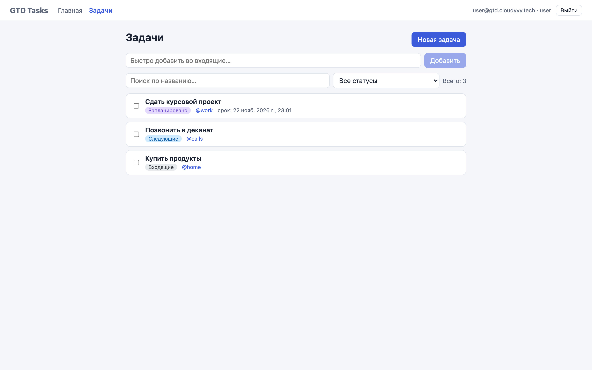{#fig:app w=150}

Для проверки работы созданы учётные записи, перечисленные в таблице @tab:creds. Администратор приложения нужен для вызова тестовой ошибки `POST /debug/sentry-test` и просмотра метрик без отдельного токена, обычный пользователь — для входа в клиент. Токен метрик вводится в форму на странице `/dashboard`.

```latex
\begin{stptable}
  \caption{Учётные записи для проверки}\label{tab:creds}
  \begin{tabularx}{\linewidth}{|>{\raggedright\arraybackslash}p{50mm}|>{\raggedright\arraybackslash}X|}\hline
    Сервис & Логин и пароль\\\hline
    Приложение, администратор & логин: \texttt{\upshape admin@gtd.cloudyyy.tech}\newline пароль: \texttt{\upshape Gtd\#7c23d22aa7d0Aa1}\\\hline
    Приложение, пользователь & логин: \texttt{\upshape user@gtd.cloudyyy.tech}\newline пароль: \texttt{\upshape Gtd\#bc45bfe7d78dUu3}\\\hline
    Дашборд метрик \texttt{\upshape /dashboard} & токен: \texttt{\upshape c1af7b3f288e087c34223f9d\newline b77accc604517111a2885625}\\\hline
    \textit{Uptime Kuma} & логин: \texttt{\upshape admin}\newline пароль: \texttt{\upshape 98d3b041ff64e857408120b1}\\\hline
    \textit{GlitchTip} & логин: \texttt{\upshape admin@gtd.cloudyyy.tech}\newline пароль: \texttt{\upshape e8f10913f84809c46c214ac3}\\\hline
    \textit{Grafana} & логин: \texttt{\upshape admin}\newline пароль: \texttt{\upshape fa84d2b3db0d15480c0166d3}\\\hline
  \end{tabularx}
\end{stptable}
```

# Выбор инструментов

Задание оставляет выбор платформ за студентом. Первоначально рассматривалась связка облачных бесплатных сервисов: Render для API, Vercel для клиента, Neon для базы данных, UptimeRobot, Better Stack и Sentry. От неё пришлось отказаться: бесплатный сервис Render засыпает после 15 минут простоя и просыпается до минуты, у базы данных, журналов и ошибок жёсткие лимиты объёма и срока хранения, а регистрация в части сервисов из Беларуси затруднена.

Поэтому всё окружение развёрнуто на арендованном виртуальном сервере (Ubuntu 20.04, 4 ядра, 6 ГБ памяти) и описано одним файлом Docker Compose. Из внешних сервисов используются только GitHub Actions и Telegram Bot API. Итоговый набор инструментов и их облачные аналоги из задания приведены в таблице @tab:tools.

Таблица: Выбранные инструменты {#tab:tools}
| Задача | Инструмент (аналог из задания) | Причина выбора |
|---|---|---|
| CI/CD | GitHub Actions (GitLab CI) | код уже на GitHub, секреты и окружения встроены |
| Хостинг API и клиента | VPS, Docker Compose, nginx, Let's Encrypt (Render, Vercel) | нет засыпания и лимитов, окружение воспроизводится одной командой |
| База данных | PostgreSQL 16 в контейнере (Neon, Supabase) | та же СУБД, что в разработке и тестах CI |
| Проверка доступности | Uptime Kuma 2.5.9 (UptimeRobot) | проверка раз в минуту, поиск ключевого слова, статус-страница |
| Журналы | Grafana Loki 3.6 и Grafana 13 (Better Stack) | запросы LogQL по JSON-полям записей, дашборды |
| Ошибки | GlitchTip 6.2.6 (Sentry) | принимает события Sentry SDK без изменения кода |
| Оповещения | Telegram Bot API (Slack) | итог сборки из CI и сообщения о падении из Uptime Kuma |
| Метрики | `/metrics` и `/dashboard` (Healthchecks.io) | собственная страница с автообновлением |

Транспорт Better Stack, написанный ранее, из кода не удалён: он по-прежнему включается переменной `LOGTAIL_SOURCE_TOKEN`, а Loki подключён рядом как второй транспорт.

Сервер общий с другими проектами, поэтому каждому контейнеру задан предел памяти, GlitchTip запущен одним процессом без Redis (очередь задач хранится в PostgreSQL, в отдельной базе `glitchtip`), Loki работает в однопроцессном режиме с хранением на диске. Все контейнеры публикуют порты только на адресе `127.0.0.1`, снаружи доступен лишь nginx хоста.

# Ход работы

## Подготовка ветки

Для работы сделан форк репозитория и создана ветка `ipr22-vps` от ветки `ipr22`, в которой уже были эндпоинты `/health` и `/metrics`, страница `/dashboard`, ESLint, тесты Jest и интеграция с Sentry. Ветка `ipr22` содержала только сервер, поэтому в неё перенесён React-клиент из ветки `kr22` вместе с двумя связанными правками API: поиском задач по параметру `q` и методом `PUT` в настройках CORS. Кроме того, в ветку добавлены:

- `docker-compose.prod.yml` — продакшен-окружение из семи контейнеров;
- `client/Dockerfile` и `client/nginx.conf` — сборка клиента и раздача статики;
- `deploy/deploy.sh` — деплой, вызываемый из CI по SSH;
- `deploy/setup-host.sh` и `deploy/nginx/` — настройка nginx хоста и выпуск сертификата;
- `deploy/loki/`, `deploy/grafana/` — конфигурация Loki, источник данных и дашборд Grafana;
- `deploy/uptime-kuma-setup.js` — настройка Uptime Kuma без ручных действий в интерфейсе;
- `.github/workflows/deploy.yml` — новый пайплайн CI/CD.

Файлы `render.yaml` и `vercel.json` удалены, так как облачные платформы не используются.

## Пайплайн CI/CD

Пайплайн срабатывает на push в ветки `main`, `ipr22` и `ipr22-vps`, на каждый pull request и на ручной запуск. Файл workflow в репозитории показан на рисунке @fig:wf.

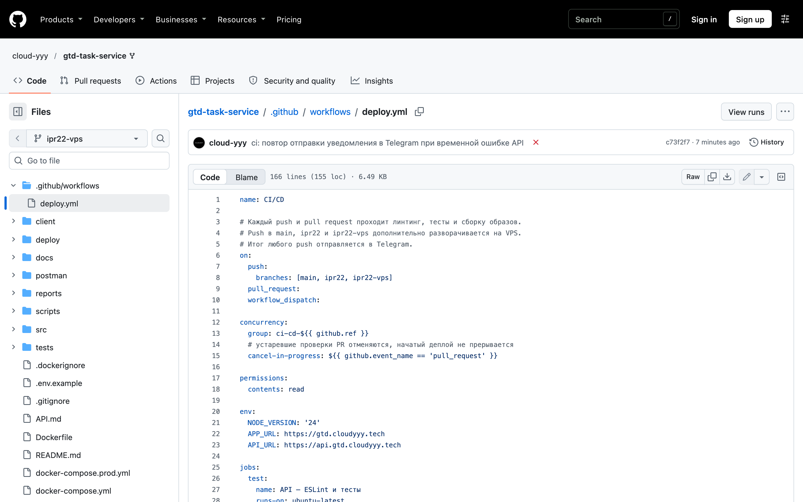{#fig:wf w=150}

Первая задача поднимает PostgreSQL как сервисный контейнер, устанавливает зависимости, запускает ESLint и 40 тестов Jest и supertest, которые обращаются к настоящему приложению и базе данных:

```yaml file=src/deploy.yml lines=26-57
```

Параллельно с ней собирается клиент Vite. Затем из того же `docker-compose.prod.yml`, что работает на сервере, собираются образы `api` и `web`, и проверяется запуск образа API. Деплой выполняется только для push в разрешённые ветки и только при заданном секрете ключа. Если секрета нет (например, в чужом форке), шаг пропускается с пометкой, и пайплайн не падает:

```yaml file=src/deploy.yml lines=95-130
```

После деплоя CI сам проверяет приложение по HTTPS: API должен ответить на `/health/ready`, фронтенд — вернуть код 200.

Последняя задача, уведомление, запускается при любом исходе предыдущих (`if: always()`). Она получает результат каждой задачи через `needs`, отмечает его значком и отправляет сообщение в Telegram методом `sendMessage`. При временной ошибке Telegram запрос повторяется до четырёх раз:

```yaml file=src/deploy.yml lines=158-166
```

В секретах GitHub хранятся только приватный ключ деплоя `VPS_SSH_KEY` и токен бота `TELEGRAM_BOT_TOKEN`. Адрес, порт и пользователь сервера, отпечатки его ключей и идентификатор чата заданы переменными репозитория. Секреты самого приложения (ключи JWT, пароль базы данных, токен метрик, пароли администраторов) в GitHub не попадают: они записаны в файл `.env` на сервере с правами `600`.

Граф задач прогона показан на рисунке @fig:run. Весь прогон занял 1 мин 49 с, из них деплой на сервер — 37 с.

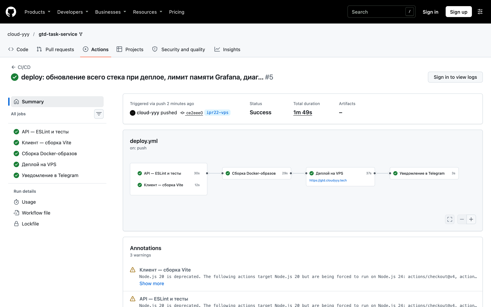{#fig:run w=150}

## Деплой на сервер

Для CI сгенерирован отдельный ключ ed25519. В `~/.ssh/authorized_keys` сервера он записан с опциями `command="…/deploy/deploy.sh",restrict`. Поэтому при подключении этим ключом сервер всегда запускает только скрипт деплоя, а интерактивная оболочка, проброс портов и агент запрещены. Строка, которую передаёт CI (`deploy <ветка>`), попадает в скрипт через переменную `SSH_ORIGINAL_COMMAND`. Скрипт берёт из неё имя ветки, сверяет его со списком разрешённых и с шаблоном допустимых символов, затем обновляет код, пересобирает контейнеры приложения и ждёт готовности API:

```bash file=src/deploy/deploy.sh lines=9-44
```

Тело скрипта обёрнуто в функцию: bash читает её целиком до выполнения, поэтому обновление самого `deploy.sh` командой `git checkout` не ломает текущий запуск. Лог шага деплоя показан на рисунке @fig:deploy: код обновлён до коммита из push, пересобраны образы, получен ответ `/health/ready` с состоянием базы данных.

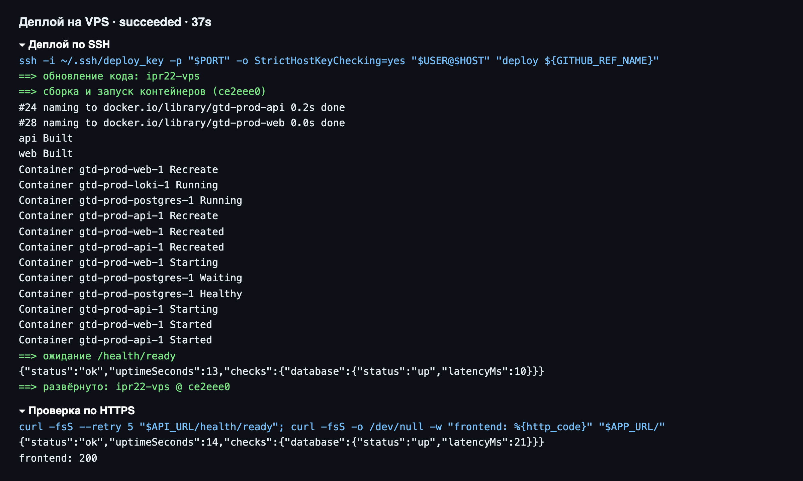{#fig:deploy w=150}

Продакшен-окружение описано в `docker-compose.prod.yml`. Ниже приведено описание контейнеров API и клиента. Адрес API и DSN GlitchTip для браузера передаются в сборку клиента аргументами, так как переменные Vite подставляются в код при сборке:

```yaml file=src/docker-compose.prod.yml lines=33-72
```

Клиент и API работают на разных именах (`gtd.cloudyyy.tech` и `api.gtd.cloudyyy.tech`), но это один сайт с точки зрения браузера. Поэтому cookie с refresh-токеном, выданная с атрибутом `SameSite=Strict` и путём `/auth`, отправляется при запросах клиента к API, а CORS разрешает ровно один источник — адрес фронтенда. Код приложения для этого менять не пришлось. Перед API стоит только nginx хоста, поэтому `TRUST_PROXY` равен 1: так ограничение частоты запросов и журнал видят реальный адрес клиента.

Конфигурация nginx хоста (`deploy/nginx/gtd.conf`) содержит блок для порта 80, который отвечает на проверку Let's Encrypt и перенаправляет остальные запросы на HTTPS, и по одному блоку `server` на каждое из пяти имён. Сертификат на все пять имён выпускается скриптом `deploy/setup-host.sh` и продлевается таймером certbot, после продления nginx перезагружается автоматически.

## Мониторинг доступности

Uptime Kuma запущена из того же compose-файла. Администратор, канал уведомлений Telegram, мониторы и статус-страница создаются скриптом `deploy/uptime-kuma-setup.js`, который подключается к Kuma по её внутреннему протоколу Socket.IO. Повторный запуск скрипта не создаёт дублей. Мониторы описаны так:

```js file=src/deploy/uptime-kuma-setup.js lines=29-45
```

Используются мониторы типа «ключевое слово»: недостаточно, чтобы адрес ответил кодом 200, в теле ответа должна быть строка, подтверждающая работу. Для API это признак доступной базы данных в ответе `/health/ready`, для клиента — корневой элемент React в HTML-странице. Проверка выполняется каждые 60 с, при ошибке — дважды повторяется через 20 с, после чего монитор считается упавшим. Дополнительно Kuma следит за сроком действия сертификата.

Для проверки контейнер API был остановлен примерно на три с половиной минуты: nginx хоста отвечал кодом 502, Uptime Kuma после двух повторных проверок отметила монитор как недоступный, а после запуска контейнера — как восстановленный, при этом клиент оставался доступен. Страница монитора API с интервалом недоступности на графике времени ответа представлена на рисунке @fig:kuma.

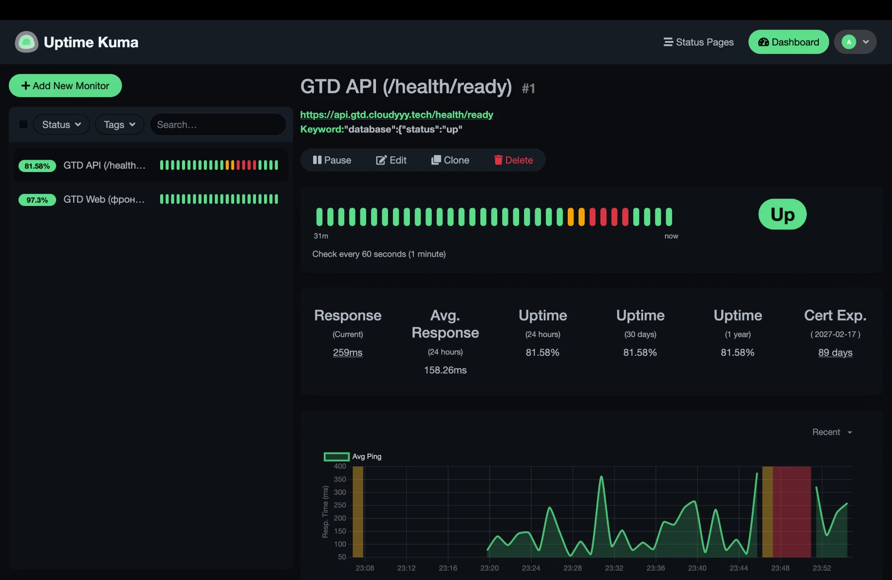{#fig:kuma w=150}

Публичная статус-страница с обоими мониторами показана на рисунке @fig:status.

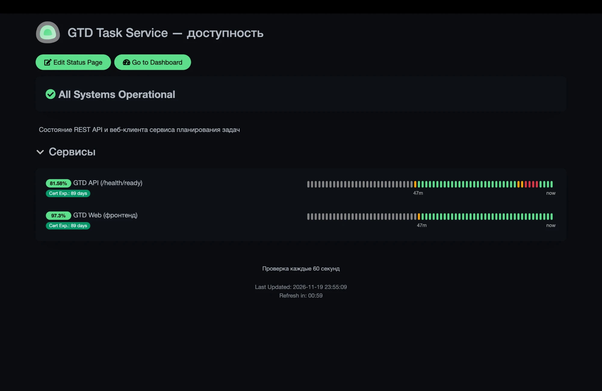{#fig:status w=150}

## Журналы

Сервер пишет журналы библиотекой winston. До этой работы у него были транспорты в консоль, в файлы с суточной ротацией и в Better Stack. Добавлен транспорт `winston-loki`, который включается переменной `LOKI_URL` и отправляет записи пачками раз в 5 с. Метка `stream` разделяет общий журнал приложения и журнал безопасности, который вёлся с первой практической работы:

```js file=src/server/logger.js lines=47-78
```

В журнал попадают старт сервера и подключение к базе данных, каждый HTTP-запрос (метод, путь, код ответа, время обработки, адрес клиента), отклонённые запросы с указанием полей, не прошедших валидацию, события безопасности (неудачный вход, неверный токен, превышение лимита, отказ по роли или CORS) и необработанные ошибки со стеком вызовов.

Loki хранит журналы 14 дней. Источник данных и дашборд Grafana подключаются автоматически при старте контейнера (provisioning), поэтому после развёртывания ничего не нужно настраивать вручную. Дашборд «GTD Task Service — журналы и запросы» строится запросами LogQL по JSON-полям записей и показывает число запросов, ответов 5xx и 4xx, подозрительных действий, распределение запросов по кодам ответа во времени, среднее и максимальное время ответа API, события безопасности по типам, а также ленты ошибок и журнала безопасности. Дашборд представлен на рисунке @fig:grafana.

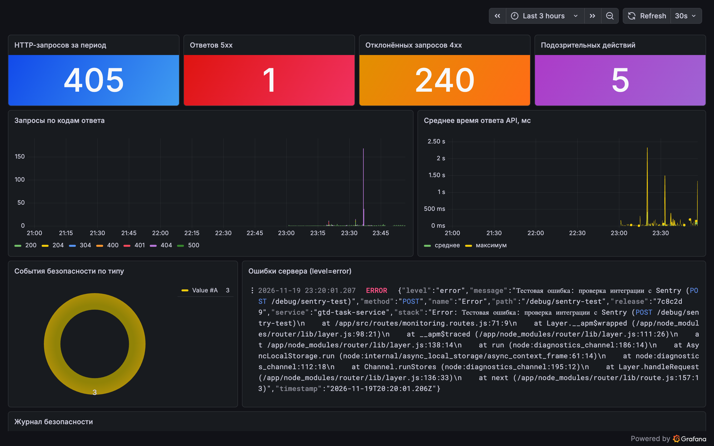{#fig:grafana w=150}

## Сбор ошибок

GlitchTip принимает события по протоколу Sentry, поэтому на сервере остался подключённый ранее `@sentry/node`, а в клиент добавлен `@sentry/react`. Перед отправкой серверного события из него удаляются заголовки `Authorization` и `Cookie`, cookie, тело запроса, а от данных пользователя остаётся только идентификатор. На клиенте интеграция вынесена в отдельный модуль, а всё приложение обёрнуто в `ErrorBoundary`, который показывает запасной экран вместо пустой страницы:

```js file=src/client/monitoring.js
```

В GlitchTip создана организация GTD Task Service и два проекта, `gtd-backend` и `gtd-frontend`, показанные на рисунке @fig:gtprojects. Браузер отправляет ошибки на публичный адрес `errors.gtd.cloudyyy.tech`, а API — напрямую контейнеру GlitchTip по внутренней сети Docker, не выходя в интернет.

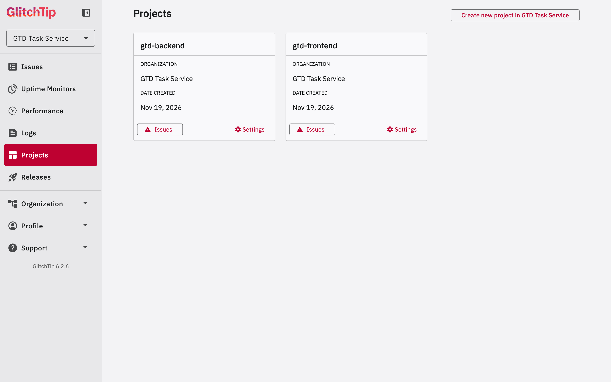{#fig:gtprojects w=150}

Для проверки используется маршрут `POST /debug/sentry-test`, доступный только администратору. Он не принимает входных данных и выбрасывает исключение. После вызова клиент получил обобщённый ответ 500 без стека, ошибка попала в журнал Grafana (рисунок @fig:grafana, панель ошибок сервера), а в GlitchTip появилось событие со стеком вызовов, версией релиза и окружением `production`, как показано на рисунке @fig:gtissue.

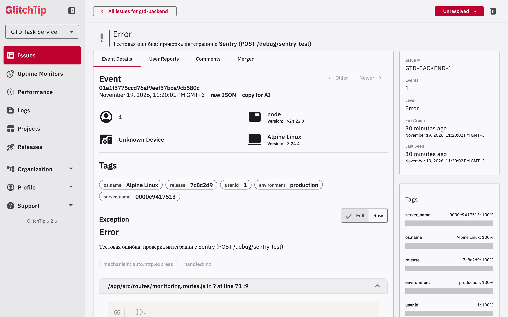{#fig:gtissue w=150}

## Метрики

Эндпоинт `/health` отвечает без обращения к базе данных и показывает, что процесс жив. Эндпоинт `/health/ready` выполняет `SELECT 1` с таймаутом 3 с и возвращает 503, если база данных недоступна; именно его опрашивают Uptime Kuma, скрипт деплоя и CI. Эндпоинт `/metrics` собирает снимок состояния процесса и системы:

```js file=src/server/metrics.js lines=44-76
```

Метрики раскрывают версию Node.js, объём памяти и профиль трафика, поэтому доступны только по статическому токену `METRICS_TOKEN` или по access-токену администратора. Токен сравнивается функцией `crypto.timingSafeEqual` по хешам SHA-256, неверные попытки записываются в журнал безопасности. Страница `/dashboard` с отдельной политикой CSP без inline-скриптов запрашивает `/metrics` с заданным периодом и выводит время работы, число обработанных запросов и среднее время ответа, память процесса, нагрузку системы и распределение ответов по классам статуса. Страница метрик представлена на рисунке @fig:metrics.

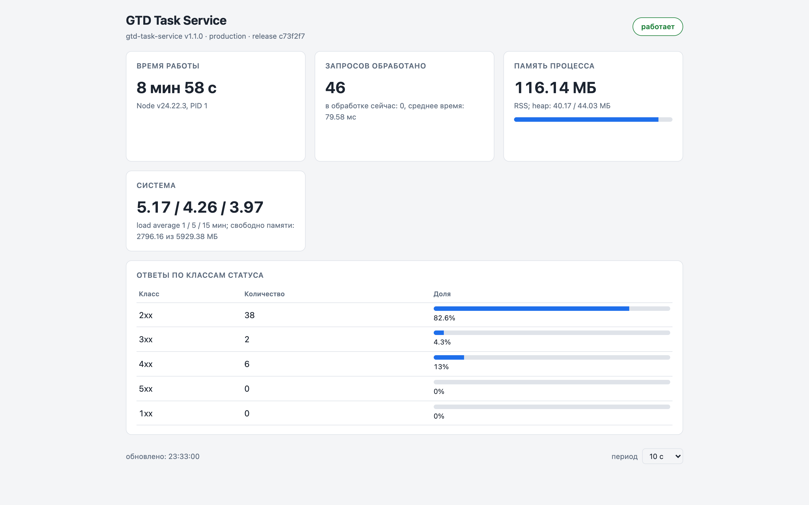{#fig:metrics w=150}

## Уведомления в Telegram

Для уведомлений используется бот «monitoring», созданный через @BotFather. Его токен хранится в секрете GitHub и в настройках канала уведомлений Uptime Kuma. Сообщение об итоге сборки отправляет последняя задача пайплайна, пример представлен на рисунке @fig:tgbuild.

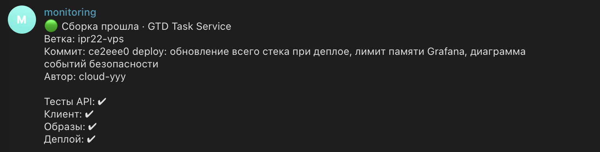{#fig:tgbuild w=150}

Сообщения о падении и восстановлении API отправляет Uptime Kuma. Уведомления, полученные при остановке контейнера API, представлены на рисунке @fig:tgdown.

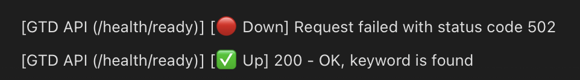{#fig:tgdown w=130}

# Ответы на контрольные вопросы

1 Какую CI/CD платформу вы выбрали и почему, структура workflow. Выбран GitHub Actions: репозиторий хранится на GitHub, отдельный сервер сборки не нужен, секреты и окружения настраиваются в самом репозитории. Workflow из пяти задач: `test` (ESLint и Jest с PostgreSQL) и `client` (сборка Vite) идут параллельно, затем `images` собирает Docker-образы, `deploy` выкладывает их на сервер, `notify` отправляет итог в Telegram. Порядок задаётся через `needs`.

2 Какие этапы проходят тесты и сборка перед деплоем. Установка зависимостей `npm ci`, проверка ESLint, 40 тестов Jest и supertest на чистой базе PostgreSQL с отчётом о покрытии, сборка клиента, сборка продакшен-образов API и клиента и пробный запуск образа API. Задача деплоя зависит от сборки образов, а та — от тестов и сборки клиента, поэтому при любой ошибке деплой не начинается.

3 Как настроен автоматический деплой без ручного вмешательства. Push в разрешённую ветку запускает пайплайн. После проверок CI подключается к серверу ключом, который может выполнить только `deploy/deploy.sh`. Скрипт обновляет код до нужного коммита, выполняет `docker compose up -d --build` для API и клиента и ждёт ответа `/health/ready`. Затем CI проверяет оба адреса по HTTPS. Если приложение не поднялось, задача завершается ошибкой, а в Telegram приходит сообщение о провале.

4 Какие секреты хранятся в CI/CD и как они защищены. В GitHub Secrets хранятся приватный ключ деплоя и токен Telegram-бота; GitHub шифрует их и маскирует в логах. Ключ деплоя выдан только для CI и ограничен опциями `command` и `restrict`, а подлинность сервера проверяется по сохранённым отпечаткам (`StrictHostKeyChecking=yes`). Секреты приложения в CI не передаются и хранятся в `.env` на сервере, доступном только владельцу.

5 Как развёрнуты backend и frontend, почему выбраны эти платформы. Оба развёрнуты на собственном VPS в Docker Compose: API на Node.js, клиент — статическая сборка React в контейнере nginx, рядом PostgreSQL и сервисы наблюдения. Снаружи стоит nginx хоста с HTTPS. Собственный сервер выбран вместо Render и Vercel, потому что он не засыпает, не ограничен лимитами бесплатных тарифов и позволяет держать всё наблюдение рядом с приложением.

6 Как обеспечивается безопасность передачи данных в продакшене. Все имена работают только по HTTPS с сертификатом Let's Encrypt, HTTP перенаправляется на HTTPS, включён заголовок HSTS. Refresh-токен передаётся в cookie с флагами `HttpOnly`, `Secure` и `SameSite=Strict`, CORS разрешает только адрес фронтенда. Порты контейнеров открыты лишь на `127.0.0.1`, поэтому база данных, Loki и внутренние сервисы из интернета недоступны.

7 Какой инструмент мониторинга uptime использован, как часто проверяется доступность. Uptime Kuma с двумя мониторами по ключевому слову: API (`/health/ready`, ответ должен подтверждать доступность базы данных) и главная страница клиента. Интервал проверки — 60 с, при ошибке два повтора через 20 с, дополнительно отслеживается срок действия сертификата.

8 Как настроены уведомления о падении сервера. В Uptime Kuma создан канал уведомлений Telegram, который подключён к обоим мониторам. При переходе монитора в состояние «недоступен» бот присылает сообщение с причиной, после восстановления — сообщение о возврате в строй. Это проверено остановкой контейнера API.

9 Как организован сбор логов, какие события логируются. Сервер через winston и транспорт `winston-loki` отправляет записи в Loki в формате JSON с метками приложения, окружения, потока и уровня; просмотр и поиск выполняются в Grafana. Логируются старт сервера, каждый HTTP-запрос с кодом и временем ответа, отклонённые запросы, события безопасности и необработанные ошибки со стеком. На сервере журналы дополнительно пишутся в файлы с ротацией.

10 Какая система сбора ошибок внедрена, как тестовая ошибка попала в дашборд. Внедрён GlitchTip с Sentry SDK на сервере и в клиенте. Администратор вызвал `POST /debug/sentry-test`, обработчик ошибок Express записал исключение в журнал и передал его в `captureException`, SDK отправил событие на DSN проекта `gtd-backend`, и в GlitchTip появилась ошибка со стеком, релизом и окружением.

11 Что такое source maps и как они помогают при отладке в production. Source map — файл, который сопоставляет строки минифицированной сборки с исходными файлами. Если загрузить его в систему сбора ошибок, стек вызовов из браузера будет показан по исходным модулям и строкам, а не по одной длинной строке бандла. Сейчас source maps клиента в GlitchTip не загружаются, поэтому ошибки фронтенда видны по собранному коду; серверный код не минифицируется и в source maps не нуждается.

12 Как создан дашборд с метриками, какие метрики отображаются. Эндпоинт `/metrics` собирает данные из `process.memoryUsage()`, `process.uptime()`, модуля `os` и счётчиков запросов, которые ведёт отдельный middleware. Страница `/dashboard` периодически запрашивает его и показывает время работы, число запросов и среднее время ответа, память процесса (RSS и heap), нагрузку системы и свободную память, распределение ответов по классам статуса. Время ответа во времени и число ошибок дополнительно показывает дашборд Grafana, процент доступности — Uptime Kuma.

13 Какие ограничения у бесплатных тарифов и как с ними справились. У облачных бесплатных тарифов бэкенд засыпает при простое, база данных ограничена по объёму и времени работы, у сервисов журналов и ошибок ограничены число событий и срок хранения. Перенос на собственный сервер снял эти ограничения, но память сервера общая. Поэтому контейнерам заданы пределы памяти, GlitchTip работает без Redis, журналы Docker ротируются, а сроки хранения журналов (14 дней) и ошибок (30 дней) ограничены.

14 Как часто обновляется деплой, что запускает пайплайн. Деплой выполняется при каждом push в `main`, `ipr22` или `ipr22-vps` и вместе с проверками занимает около двух минут. Push в другие ветки и pull request запускают только проверки и сборку. Кроме того, пайплайн можно запустить вручную.

15 Какие меры приняты, чтобы логи и ошибки не содержали чувствительных данных. В журнал не записываются тела запросов, пароли и токены; для отклонённых запросов пишутся только имена полей с ошибкой, без значений. Перед отправкой в GlitchTip из события удаляются заголовки авторизации и cookie, тело запроса, а от пользователя остаётся только идентификатор. Регистрация в GlitchTip и Grafana закрыта, метрики защищены токеном.

16 Что улучшить в мониторинге для коммерческого проекта. Вынести проверку доступности на независимую площадку, так как Uptime Kuma работает на том же сервере и не сообщит о падении всего VPS. Добавить Prometheus и экспортёры метрик сервера и контейнеров, правила оповещения Grafana по росту ошибок и времени ответа, уведомления GlitchTip о новых ошибках, загрузку source maps клиента, резервное копирование базы данных и тестовое окружение перед продакшеном.

# Репозиторий

Исходный код, файлы CI/CD, конфигурации и `README.md` со ссылками на приложение, мониторинг, сбор ошибок и журналы находятся в репозитории https://github.com/cloud-yyy/gtd-task-service, ветка `ipr22-vps`. В разделе README «Мониторинг и деплой» описаны схема, секреты и порядок развёртывания с нуля.

# Заключение

Для сервиса GTD Task Service настроен пайплайн GitHub Actions: каждое изменение кода проходит линтинг, тесты на чистой базе PostgreSQL, сборку клиента и Docker-образов, а push в ветку деплоя автоматически выкладывается на сервер и проверяется по HTTPS. Ключ деплоя ограничен запуском одного скрипта, секреты приложения в CI не передаются, о результате каждой сборки сообщает Telegram-бот.

Фронтенд и API доступны по постоянным адресам с HTTPS. Вокруг приложения развёрнута система наблюдения: Uptime Kuma раз в минуту проверяет API и клиент по содержимому ответа и сообщает о падении и восстановлении в Telegram, журналы сервера собираются в Loki и анализируются на дашборде Grafana, необработанные ошибки сервера и браузера попадают в GlitchTip со стеком вызовов, а состояние процесса видно на странице метрик. Работа каждого компонента подтверждена прогоном пайплайна, остановкой API, тестовой ошибкой и просмотром журналов.
